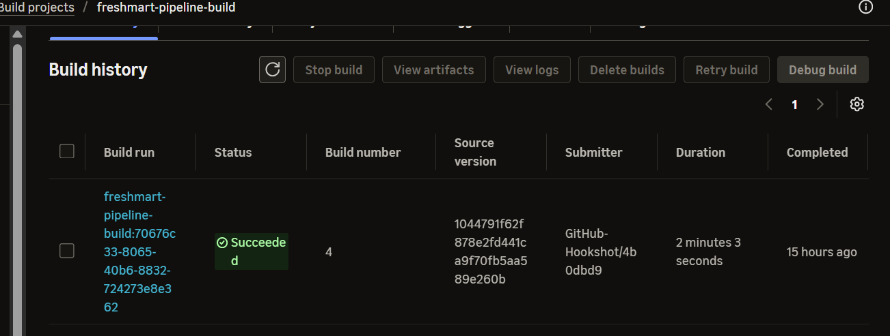
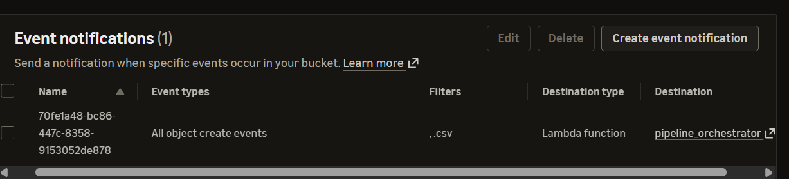
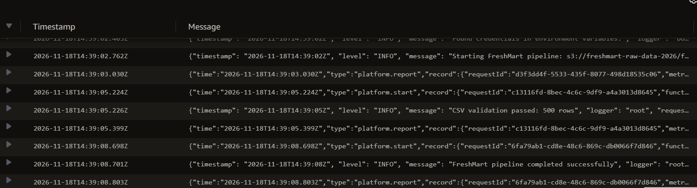

# FreshMart Analytics — Automated AWS Data Pipeline with CI/CD
## 1. Project Overview

FreshMart Analytics is an event-driven data processing pipeline built using AWS Lambda, Amazon S3, Python, GitHub, and AWS CodeBuild.

The pipeline automatically validates and transforms retail sales data when a CSV file is uploaded to an S3 bucket. It uses AWS Lambda Durable Functions to coordinate processing steps and GitHub-integrated CodeBuild to automate testing and deployment.

### Key Features

- Event-driven CSV ingestion from Amazon S3.
- CSV validation using Python and Pandas.
- Durable orchestration of Lambda functions.
- Data cleansing, calculated sales amounts, and rating classification.
- Automated testing, linting, and packaging.
- GitHub-based CI/CD deployment to AWS Lambda.
- Published Lambda versions and a `live` alias for the orchestrator.

## 2. Solution Architecture

```text
                  Amazon S3
             freshmart-raw-data-2026
                       |
                 CSV uploaded
                       |
                 S3 Event Trigger
                       |
                       v
            pipeline_orchestrator:live
             (AWS Durable Lambda)
                       |
              +--------+--------+
              |                 |
              v                 |
       csv_reader_lambda        |
       Validate CSV file        |
              |                 |
              +-----------------+
                       |
                       v
             data_transformer_worker
             Clean and transform data
                       |
                       v
                  Amazon S3
          freshmart-processed-data-2026
                processed/*.csv
```

The orchestrator invokes the CSV reader and transformer in sequence. AWS CloudWatch provides execution logs and monitoring.

### CI/CD Architecture

```text
GitHub Feature Branch
         |
         v
       develop
         |
      Pull Request
         |
         v
        main
         |
      GitHub Push
         |
         v
   AWS CodeBuild Webhook
         |
         v
   Install Dependencies
         |
   Syntax + Ruff + Pytest
         |
     Package ZIPs
         |
         v
   Deploy Lambda Functions
         |
   Publish Orchestrator Version
         |
   Update live Alias
```

## 3. Repository Structure

```text
freshmart-data-pipeline/
├── .gitignore
├── README.md
├── buildspec.yml
├── requirements-dev.txt
├── data/
│   └── freshmart_sales.csv
├── lambdas/
│   ├── csv_reader/
│   │   ├── lambda_function.py
│   │   └── requirements.txt
│   ├── orchestrator/
│   │   ├── lambda_function.py
│   │   └── requirements.txt
│   └── transformer/
│       ├── lambda_function.py
│       └── requirements.txt
├── scripts/
│   ├── deploy.sh
│   ├── generate_mock_data.py
│   ├── codebuild-lambda-policy.json
│   ├── codebuild-trust-policy.json
│   ├── lambda-invoke-policy.json
│   ├── lambda-s3-policy.json
│   └── lambda-trust-policy.json
└── tests/
    ├── test_csv_reader.py
    └── test_transformer.py
```

The `screenshots/` directory will contain the final AWS execution and CI/CD evidence.

## 4. AWS Prerequisites and Setup

### Prerequisites

- AWS account with appropriate IAM permissions.
- AWS CLI configured with valid credentials.
- Python 3.13.
- Git and GitHub repository.
- Amazon S3, AWS Lambda, IAM, CloudWatch, and CodeBuild access.
- Bash environment for deployment scripts.
- AWS Lambda Durable Functions support in the selected region.

### AWS Region

```text
ap-south-2 (Hyderabad)
```

### S3 Buckets

| Bucket | Purpose |
|---|---|
| `freshmart-raw-data-2026` | Stores incoming sales CSV files |
| `freshmart-processed-data-2026` | Stores transformed CSV files and CodeBuild artifacts |

Processed files are written under the `processed/` prefix.

### Lambda Functions

| Function | Responsibility |
|---|---|
| `csv_reader_lambda` | Reads and validates incoming CSV data |
| `data_transformer_worker` | Applies transformation and filtering rules |
| `pipeline_orchestrator` | Coordinates the workflow using durable execution |

The orchestrator uses the published `live` alias as the S3 event destination.

### IAM Roles and Permissions

**Lambda execution role:** `freshmart-lambda-execution-role`

Required permissions include:

- CloudWatch Logs permissions for Lambda execution logs.
- S3 read access to the raw data bucket.
- S3 write access to the processed data bucket.
- `lambda:InvokeFunction` for worker invocation.
- AWS Lambda durable execution permissions.

**CodeBuild service role:** `freshmart-codebuild-service-role`

Required permissions include:

- CloudWatch Logs access.
- S3 artifact access.
- Access to the configured GitHub connection credentials.
- `lambda:UpdateFunctionCode`.
- `lambda:GetFunction` and `lambda:GetFunctionConfiguration`.
- `lambda:PublishVersion` and `lambda:UpdateAlias` for the orchestrator.

IAM policy and trust policy examples are provided in the `scripts/` directory. Policies should be reviewed and scoped to the target AWS account and resources before reuse.

## 5. CSV Input and Transformation Rules

### Required Input Columns

The input CSV must contain the following nine columns:

```text
invoice_id
branch
city
product_line
unit_price
quantity
date
payment
rating
```

### CSV Reader

The CSV reader validates the required columns and ensures the input is not empty.

Execution information includes:

- Input filename.
- Number of rows.
- Number of columns.
- UTC processing timestamp.

### Data Transformer

The transformer performs the following operations:

**Sales amount calculation**

```python
total_amount = unit_price * quantity
```

**Rating classification**

| Rating | Category |
|---|---|
| Below 5 | Low |
| 5 through 7 | Medium |
| Above 7 | High |

**Invalid-record filtering**

Records are excluded when:

```python
quantity == 0 or unit_price == 0
```

The transformer also parses the date column and saves the processed output as a CSV file in Amazon S3.

## 6. Manual Deployment — Initial Setup

The initial deployment requires AWS infrastructure to be provisioned before automated CI/CD can run.

### Step 1 — Create S3 Buckets

Create the raw and processed S3 buckets in `ap-south-2`.

Ensure bucket names are globally unique. If different bucket names are used, update the corresponding configuration and environment variables.

### Step 2 — Configure IAM

Create the Lambda execution role and attach the required logging, S3, Lambda invocation, and durable execution permissions.

Create the CodeBuild service role with permissions for source access, logs, artifacts, and Lambda deployment.

Review the example IAM policies in `scripts/`.

### Step 3 — Create Lambda Functions

Create these functions using Python 3.13:

```text
csv_reader_lambda
data_transformer_worker
pipeline_orchestrator
```

The orchestrator must be created with AWS Lambda durable execution configuration.

Configure these environment variables:

**Orchestrator**

```text
CSV_READER_FUNCTION=csv_reader_lambda
TRANSFORMER_FUNCTION=data_transformer_worker
```

**Transformer**

```text
DESTINATION_BUCKET=freshmart-processed-data-2026
```

### Step 4 — Package Lambda Code

Create deployment ZIP files containing each function's source code and required dependencies.

The packages must be compatible with the AWS Lambda Python runtime.

### Step 5 — Deploy the Functions

Once the functions exist and ZIP packages are prepared, use:

```bash
bash scripts/deploy.sh csv_reader_lambda dist/csv_reader.zip

bash scripts/deploy.sh data_transformer_worker dist/transformer.zip

bash scripts/deploy.sh pipeline_orchestrator dist/orchestrator.zip
```

The deployment script updates the function code and waits for completion.

For the orchestrator, it also publishes a new version and updates the existing `live` alias.

**Important:** On the first deployment, create the `live` alias before running the alias-aware deployment script. The script updates an existing alias; it does not create one.

### Step 6 — Configure S3 Event Notification

Configure the raw S3 bucket to invoke:

```text
pipeline_orchestrator:live
```

Use the event type:

```text
s3:ObjectCreated:*
```

Configure the `.csv` suffix filter and grant S3 permission to invoke the qualified Lambda alias.

### Step 7 — Test the Pipeline

Upload a CSV file:

```bash
aws s3 cp data/freshmart_sales.csv \
  s3://freshmart-raw-data-2026/freshmart_sales.csv \
  --region ap-south-2
```

Verify the processed output:

```bash
aws s3 ls \
  s3://freshmart-processed-data-2026/processed/ \
  --region ap-south-2
```

Check CloudWatch logs and durable execution status to confirm successful processing.

## 7. GitHub Branching Strategy

The repository follows a feature-based branching workflow:

```text
feature/* → develop → main
```

- `feature/*` branches are used for isolated development.
- `develop` integrates completed features.
- `main` contains the deployment-ready code.

The project completed six feature-to-develop pull requests and one develop-to-main pull request.

## 8. Automated CI/CD Using AWS CodeBuild

### CodeBuild Project

```text
freshmart-pipeline-build
```

The project uses an AWS-managed Linux build environment and the repository's `buildspec.yml`.

### Webhook Configuration

CodeBuild is configured with the following webhook filters:

```text
EVENT: PUSH
HEAD_REF: ^refs/heads/main$
```

Only pushes to `main` match the configured webhook filters.

### CI/CD Execution

On a qualifying GitHub push, CodeBuild:

1. Downloads the source code.
2. Installs development and Lambda dependencies.
3. Performs Python syntax checks.
4. Runs Ruff linting.
5. Executes pytest unit tests.
6. Packages all three Lambda functions.
7. Deploys the updated packages.
8. Publishes a new orchestrator version.
9. Updates the orchestrator's `live` alias.

The deployment commands are guarded so failures stop the deployment sequence.

### Automatic Deployment Verification

The final GitHub merge triggered the following CodeBuild execution:

```text
Build ID:
freshmart-pipeline-build:70676c33-8065-40b6-8832-724273e8e362

Build Status: SUCCEEDED
Build Phase: COMPLETED
Initiator: GitHub-Hookshot
```

Following deployment, the orchestrator's `live` alias was verified to point to version `2`.

## 9. Testing and Validation

### Unit Tests

The CodeBuild environment successfully executed the project unit tests.

Previously verified CodeBuild test execution:

```text
13 tests passed
```

### End-to-End Test

The final end-to-end test used the generated FreshMart sales dataset.

| Metric | Result |
|---|---:|
| Input records | 500 |
| Filtered records | 13 |
| Valid output records | 487 |
| Final processed file size | 33,790 bytes |

Final input object:

```text
s3://freshmart-raw-data-2026/freshmart_final_test.csv
```

Final output object:

```text
s3://freshmart-processed-data-2026/processed/freshmart_final_test.csv
```

The final output was downloaded and validated using PowerShell:

```powershell
(Import-Csv .\freshmart_final_test_output.csv).Count
```

Result:

```text
487
```

This confirms that the deployed pipeline generated the expected number of valid records.

## 10. Screenshots and Execution Evidence

The following screenshots demonstrate successful execution of the
FreshMart AWS data pipeline and automated CI/CD workflow.

### 10.1 Successful CodeBuild Execution from main



The GitHub webhook automatically triggered CodeBuild after merging
develop into main. The build completed with SUCCEEDED status.

Build commit: `1044791f62f878e2fd441ca9f70fb5aa589e260b`

This commit was verified against `origin/main`.

### 10.2 S3 Event Trigger Configuration



The raw S3 bucket is configured to invoke
`pipeline_orchestrator:live` whenever a CSV file is uploaded.

### 10.3 CloudWatch Lambda Execution Logs



CloudWatch logs confirm:
- FreshMart pipeline started from an S3 event.
- CSV validation passed for 500 records.
- The pipeline completed successfully.

The final processed CSV contained 487 valid records after filtering
13 invalid records.

## 11. Assumptions and Design Decisions

1. **Mock dataset:** A generated 500-row retail sales dataset is used because production sales data was not provided.
2. **Event-driven ingestion:** S3 ObjectCreated events automatically initiate processing.
3. **CSV validation:** Input files must contain the required nine columns and at least one record.
4. **Invalid records:** Records with zero quantity or zero unit price are excluded.
5. **Rating boundaries:** Ratings of exactly 5 and 7 are classified as Medium.
6. **Durable orchestration:** AWS Lambda Durable Functions coordinate the validation and transformation workflow.
7. **Modular Lambda design:** Reading, transformation, and orchestration are separated into individual functions.
8. **Versioned deployment:** The orchestrator uses a published Lambda version and `live` alias to maintain a stable S3 trigger destination.
9. **Main-only CI/CD:** GitHub webhook filters restrict automatic builds to pushes on `main`.
10. **Deployment safety:** CI/CD performs checks before deployment and stops the deployment sequence if a deployment command fails.
11. **AWS region:** Resources are deployed in `ap-south-2`.
12. **Secrets management:** AWS credentials and GitHub tokens are not committed to the repository.

## 12. Technologies Used

- Python 3.13
- Pandas
- Boto3
- AWS Lambda and Lambda Durable Functions
- Amazon S3
- AWS IAM
- Amazon CloudWatch
- AWS CodeBuild
- Git and GitHub
- Pytest
- Ruff
- Bash

## 13. Project Outcome

The FreshMart Analytics project demonstrates an automated, event-driven AWS data pipeline with GitHub-based CI/CD.

The final deployment successfully processed 500 input records, removed 13 invalid records, and generated 487 valid output records in Amazon S3.

The project also demonstrates automated testing, Lambda packaging, version publishing, and alias-based deployment through AWS CodeBuild.